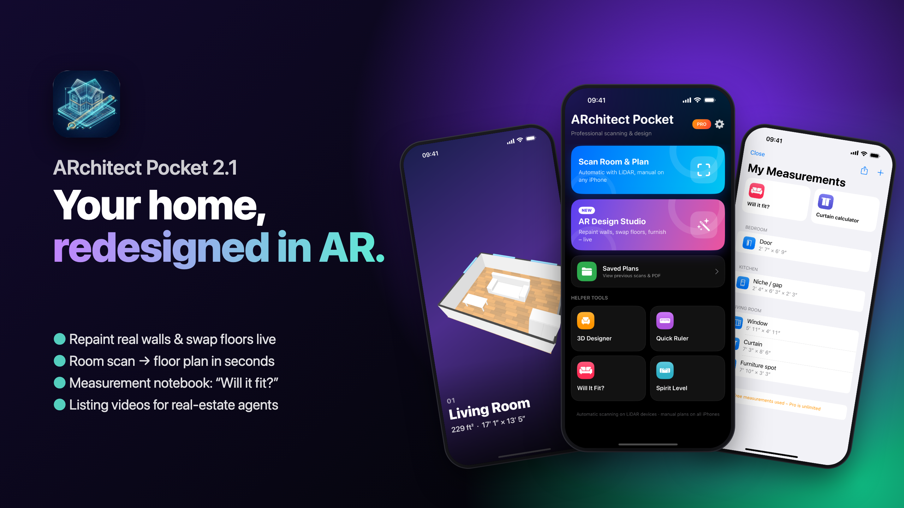
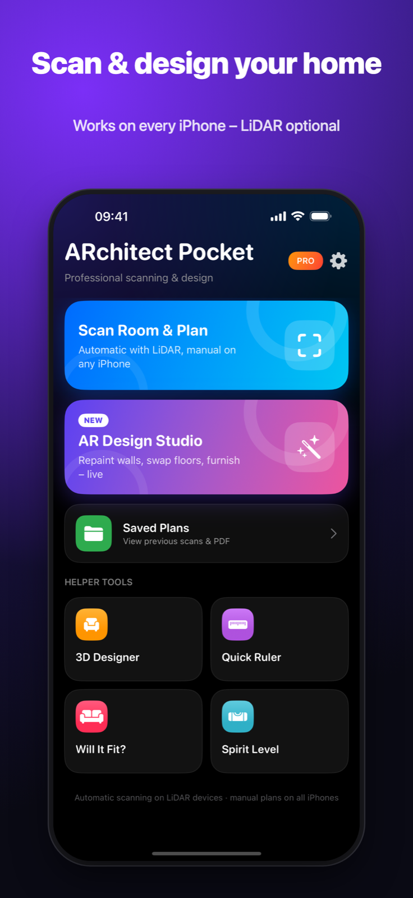
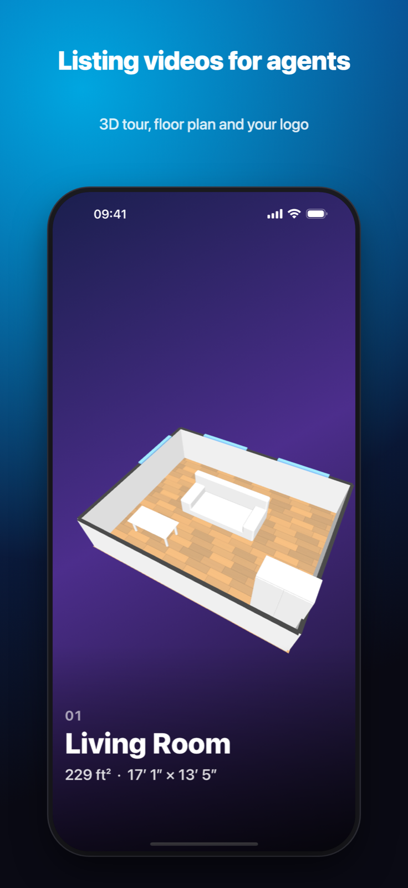
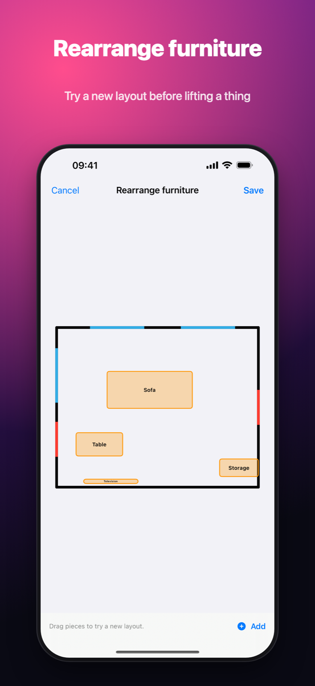
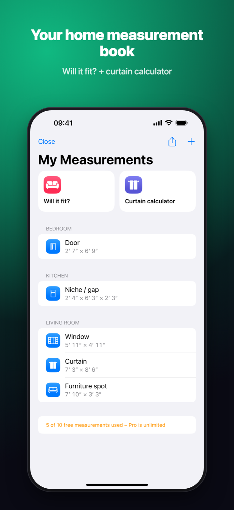
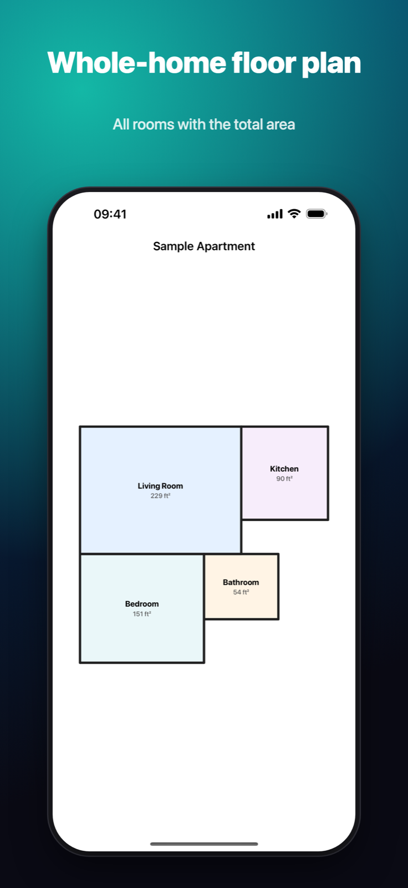
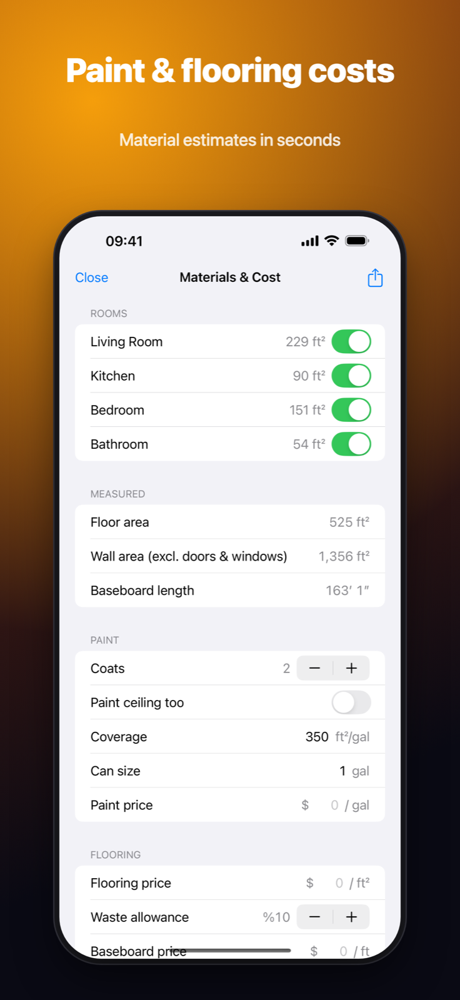

# ARchitect Pocket – Press Kit

**Your home, redesigned in AR.**

[Download on the App Store](https://apps.apple.com/app/id6758917520)

## What's new in 2.1

- **AR Design Studio** – repaint real walls and swap floors live. On LiDAR iPhones the paint follows the classified wall mesh, so furniture and people stay in front of it. Works on every iPhone via plane detection.
- **Furniture in AR** – true-scale sofas, tables and beds, before/after compare.
- **My Measurements** – save window, curtain, door and niche sizes; "Will it fit?" check and a curtain sewing calculator.
- **Listing videos** – 9:16 video with 3D tour and floor plan for real-estate agents.
- Room scan to floor plan PDF, whole-home map, paint and flooring cost estimates.

Localized in 9 languages: English, Turkish, German, Spanish, French, Italian, Portuguese (Brazil), Japanese, Arabic.

## Screenshots

| | | |
|---|---|---|
|  |  |  |
|  |  |  |

## Assets

- [Feature card 2560×1440](feature_card_2560x1440.png)
- [App icon 1024×1024](app_icon_1024.png)
- [App preview video](app_preview.mp4)

## Contact

Mesut Dokumacı – independent developer, Türkiye
mesut_dokumaci@hotmail.com
